# lumap

**A REX Technologies product.** Projection mapping that you can trust on show day, and
that a first-timer can run in two minutes. Website: <https://tochi-mba.github.io/lumap/>.

lumap maps video, images, loops and live inputs onto physical surfaces through one or many
projectors. It is a native Rust application (egui editor, wgpu renderer) with a few deliberate
differences from the usual tools:

- **Easiest calibration.** Plug in the projectors, open lumap, click *Create outputs*: every
  display gets a full-size output with a grid. Drag corners on the canvas or directly on the
  wall, with zoom, snapping, numeric readouts and an *Identify* flash so four projectors never
  get mixed up. The stage view shows the whole wall to scale; *Suggest blends* sets the
  overlap fades for you; calibration overlays and a gamma-match tool hide the seams.
- **Provably correct geometry.** Corner-pin warps are true homographies with
  perspective-correct sampling; curved surfaces use bicubic Bezier meshes; overlaps blend in
  linear light with gamma-correct falloffs. A CPU reference renderer is the specification,
  golden images come from it, and the GPU renderer is compared against it on every push.
- **A real show, not a demo.** Video through `ffmpeg`, image sequences and GIFs, six animated
  generators, Spout senders on Windows; cues with crossfades; GO from the keyboard, OSC, a
  MIDI controller (learn any fader or button) or a phone on the Wi-Fi; OSC feedback so your
  TouchOSC layout follows the app.
- **Show-day reliability.** Locked show mode (double-Escape to leave), autosave with crash
  recovery, atomic project writes, a render-loop watchdog that can relaunch the show, and a
  startup self-check that opens every enabled output where the project says it belongs.
- **A camera that maps for you.** Point a webcam at the wall and *Scan the room*: lumap learns
  where every projector pixel lands, shows the wall under the canvas, finds the surfaces worth
  mapping, measures the blends and re-aligns a bumped projector. Room effects react to people's
  shadows; paint on the wall with a torch or your hand; zones and gestures fire cues.
- **Plain-text projects.** `.lumap.toml` files are small, diffable and versioned with
  migrations, so a show lives happily in git. Cues and MIDI maps travel with it.
- **Scriptable, testable, free.** `lumap render` draws any output to PNG without a window; the
  whole app, UI included, is covered by headless tests. MIT OR Apache-2.0, one executable, no
  watermark, no subscription.

| Left output of the demo, blended right edge | Right output: overlap, screen-mode logo, feathered mask | Bezier mesh on a curve |
|---|---|---|
|  |  |  |

| Six generators at one instant | Grid overlay on a checker (never shown in show mode) |
|---|---|
| 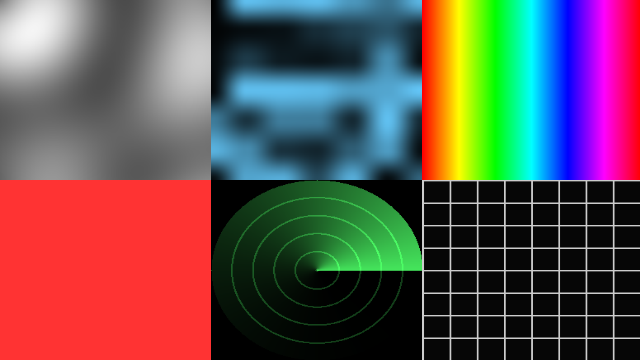 |  |

| The editor on the demo project | The welcome screen |
|---|---|
| 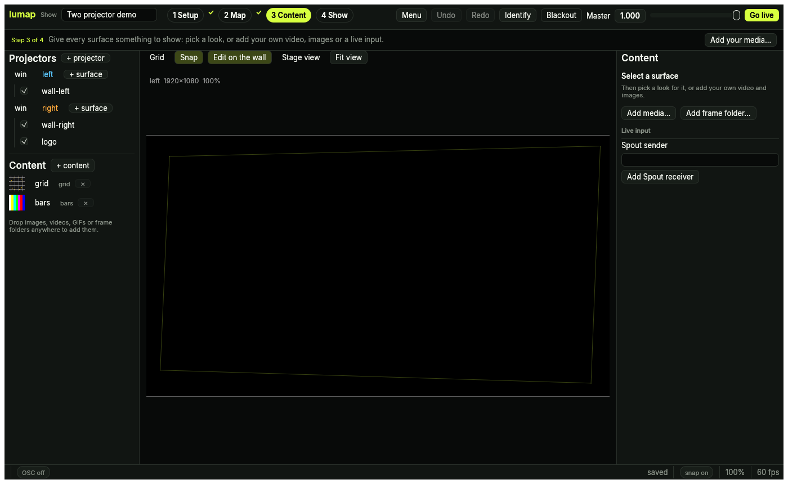 | 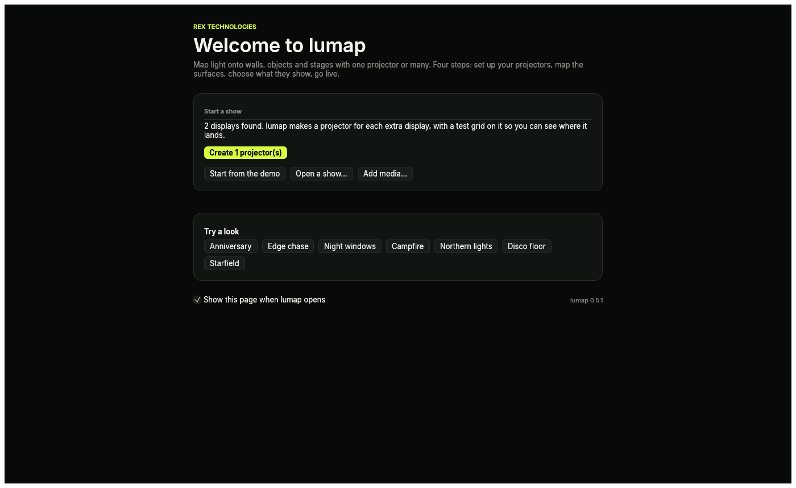 |

## Two-minute start

1. Download and run [`lumap-Setup.exe`](https://github.com/tochi-mba/lumap/releases/latest/download/lumap-Setup.exe)
   (installs for you only, no administrator prompt, ffmpeg included). Prefer no installer? Each
   release also has `lumap-<version>-windows-x64.zip`: unzip and run `lumap.exe`. Or build:
   `cargo build --release -p lumap-app --features spout`.
2. **1 Setup.** The start page lists your displays. Click **Create N projector(s)**: each
   secondary display gets a borderless projector window showing an alignment grid. Press
   **I** to flash each projector's name on its wall.
3. **2 Map.** Drag the four corner handles on the canvas (or on the wall itself) until the
   grid sits on the surface. Scroll to zoom, **G** for a grid, **S** for snapping, arrows to
   nudge.
4. **3 Content.** Click a look in the library, or **Add media…** (or drop files on the window),
   and drag it onto a surface.
5. **4 Show.** Set up a look, press **Store this look**, change something, store another.
   **GO** (or **Space**) fades between them. **Go live** checks the show and locks it.
   Ctrl+S saves everything to one TOML file.

The full guide is [docs/manual.md](docs/manual.md).

## Looks

Built-in animated content that needs no media: pick one on the welcome screen (*Try a look*),
in a surface's inspector (*Looks*, then *Apply look*), or from the command line with
`lumap new show.lumap.toml --look "Anniversary"`. `lumap looks` lists them all. Every look is a
generator with a colour, a speed and a blend mode you can change afterwards, and each one is
drawn by the same CPU reference renderer the GPU is tested against. Also: *Candlelight*
(slow warm fire), *Plasma* and *Radar*.

| Look | What it does | Preview |
|---|---|---|
| **Anniversary** | Soft hearts drifting up, beating together | 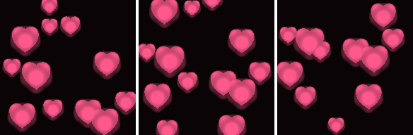 |
| **Edge chase** | A light running round the edge | 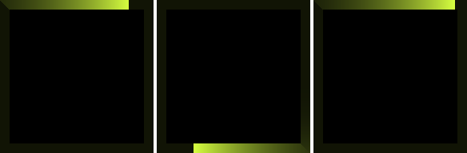 |
| **Neon outline** | A breathing neon border | 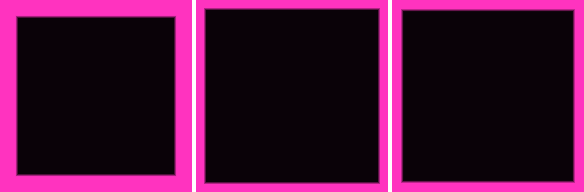 |
| **Scanner** | A light bar sweeping across, then down | 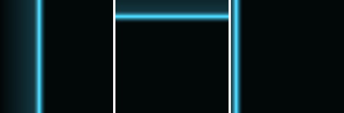 |
| **Breathing bricks** | A brick wall breathing in waves | 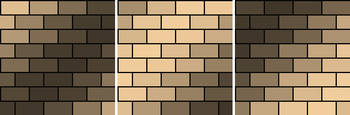 |
| **Night windows** | Windows lighting up and going dark | 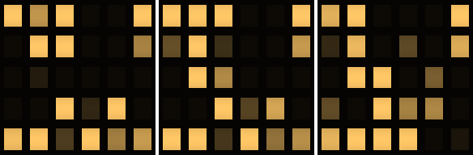 |
| **Tetris** | Blocks falling and stacking | 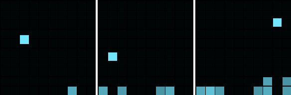 |
| **Wire cube** | A rotating wireframe cube | 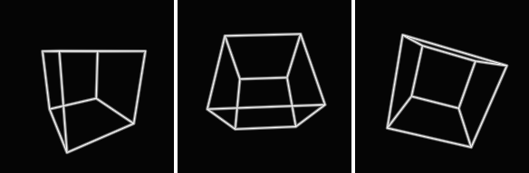 |
| **Rain on glass** | Ripples spreading across | 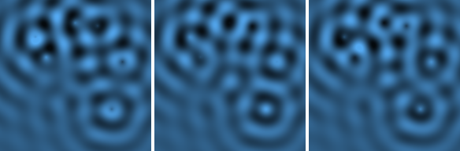 |
| **Campfire** | Flames rising |  |
| **Northern lights** | Slow curtains of light | 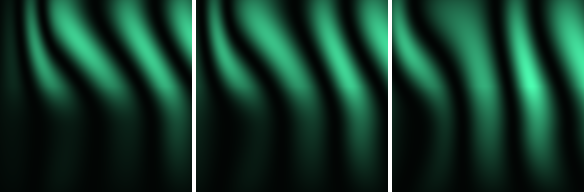 |
| **Starfield** | Twinkling stars drifting | 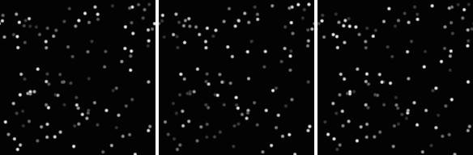 |
| **Disco floor** | Tiles flashing on the beat | 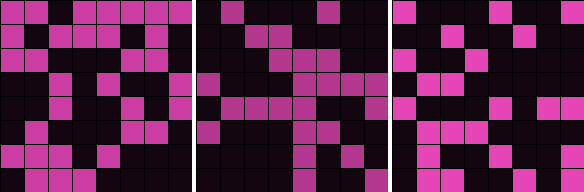 |
| **Kaleido** | A turning kaleidoscope | 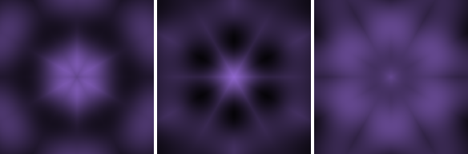 |

## Use

```text
lumap                              open the editor (welcome screen, or the demo)
lumap show.lumap.toml              open a project
lumap show show.lumap.toml         straight into locked show mode, outputs open
lumap show show.lumap.toml --remote-port 8080 --osc-port 9000 --restart-on-stall 5
lumap render show.lumap.toml --out frames/     PNG per output, headless
lumap validate show.lumap.toml     check references and geometry (exit 1 on errors)
lumap migrate old.lumap.toml       rewrite in the current schema
lumap new my-show.lumap.toml       write the two-projector demo
```

### Objects

- **Outputs** are projectors: size, enabled-in-show, colour (brightness, contrast, gamma),
  four-edge blend (width, curve, blend gamma), placement on a monitor, and a calibration
  overlay (grid, crosshair, colour bars, grey steps, blend check).
- **Surfaces** place a source on an output: corner-pin or Bezier mesh, opacity, z-order,
  blend mode, crop (drag it on the preview) and feathered polygon masks. Lock, duplicate,
  rename, reorder, align (flip, rotate, fit, centre, match aspect).
- **Sources**: test patterns, solid colours, PNG/JPEG, video (any format `ffmpeg` reads),
  numbered image sequences, GIFs, generators (plasma, noise, colour cycle, strobe, radar,
  grid pulse) and Spout senders. Video, sequences and generators share a transport (play,
  loop, speed, restart).
- **Cues** snapshot every live parameter with a fade time. GO fades numbers and switches
  booleans half way.

### Control

| Way in | What it does |
|---|---|
| Keyboard | `Space` GO, `B` blackout, `I` identify, `T` stage view, `[`/`]` blend gamma, `?` the full list |
| OSC (`--osc-port`, default 9000) | `/show/blackout`, `/show/master`, `/surface/<id>/opacity`, `/output/<id>/blend/<edge>/width`, `/source/<id>/play`, `/cue/go`, `/cue/<id>/go`, `/cue/stop` … every live parameter |
| OSC feedback | Show inspector → *Feedback host:port*: every change is echoed back |
| MIDI | Show inspector → open a port, type an address (or press *MIDI learn opacity* on a surface), move a control. Fader, button and switch modes; saved in the project |
| Phone | *Start remote* (or `--remote-port 8080`), scan the QR code: blackout, master, levels, opacities and the cue list from any browser |

### Project file

```toml
schema_version = 1
name = "Two projector demo"

[[sources]]
id = "loop"
kind = "video"
path = "media/loop.mp4"
playback = { looping = true, speed = 1.0 }

[[outputs]]
id = "left"
width = 1920
height = 1080
placement = { monitor = '\\.\DISPLAY2', x = 1920, y = 0 }
[outputs.blend]
right = { width = 0.2, curve = "smooth" }
gamma = 2.2

[[surfaces]]
id = "wall-left"
output = "left"
source = "loop"
warp = { kind = "quad", corners = [{ x = 0.05, y = 0.08 }, { x = 0.98, y = 0.04 }, { x = 0.96, y = 0.95 }, { x = 0.03, y = 0.9 }] }

[[cues]]
id = "opening"
fade_seconds = 3.0
[cues.values]
"/show/master" = 1.0
"/surface/wall-left/opacity" = 1.0
```

See `examples/two-projector-demo.lumap.toml` for the full demo.

## Development

```bash
cargo xtask ci          # file lengths, fmt, clippy -D warnings, docs, cargo-deny, tests, coverage floors
```

Crates: `lumap-core` (geometry, blending, project format, cues, MIDI map, undo),
`lumap-sources` (patterns, images, video, sequences, generators, Spout), `lumap-render`
(software oracle + wgpu), `lumap-control` (OSC in and out, MIDI, the phone remote),
`lumap-app` (editor, show player, CLI). `CLAUDE.md` describes the layout and conventions;
`CONTRIBUTING.md` the workflow.

Headless GPU tests need a Vulkan adapter; on Linux without a GPU install Mesa's lavapipe
(`mesa-vulkan-drivers`) and run with `WGPU_BACKEND=vulkan`. Video tests need `ffmpeg`; MIDI
needs `libasound2-dev` to build on Linux.

Spout is compiled on Windows (MSVC, x64) from the vendored Spout2 SDK and needs a GPU at run
time; CI builds it, a projector proves it.

## Roadmap

NDI, Spout sending, camera-assisted calibration, 3-D model mapping, DMX/Art-Net, LED pixel
mapping, output windows on macOS and Linux with per-monitor DPI.

## Licence

Copyright REX Technologies. MIT OR Apache-2.0, at your option. Spout2 (vendored by `spout2-rs`) is BSD-2-Clause.
